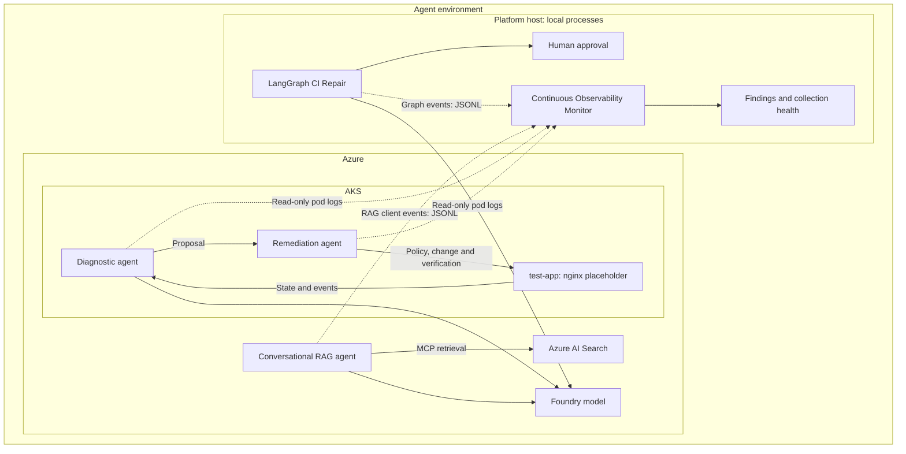

# Agents Platform — one-command Azure lab

> **Test workload:** `test-app` is a disposable nginx placeholder used only for fault injection and recovery checks. It has no business logic, payment processing, business data or extra backend. `tset-app` is the deliberately misspelled image alias used in the recovery scenario.

A shared Azure test bench for AKS Agentic Ops, Foundry RAG, LangGraph CI Repair
and the Observability Monitor. Bicep owns infrastructure; application adapters
reuse those resources. Each source repository retains its independent lab scripts.

## Running agents



The monitor observes **both AKS agents, RAG client executions and CI graph executions**.
RAG telemetry is emitted by the application client around actual Foundry responses;
it does not observe unrelated conversations initiated outside that client.
No monitoring arrow gives the monitor a remediation or approval capability.

## Up / status / down

Requirements: Python 3.12+, PowerShell 7+, Git, Azure CLI with Bicep, kubectl,
an Azure login and permission to deploy resources, build images in ACR and assign roles.
Docker is not required locally: image builds run in ACR.

```powershell
az login
az account set --subscription YOUR_SUBSCRIPTION_ID
./up.ps1 -Yes
./status.ps1
./down.ps1 -Yes
```

For a different dedicated resource group/region:

```powershell
./up.ps1 -ResourceGroup rg-agents-demo -Location westeurope -Yes
./down.ps1 -ResourceGroup rg-agents-demo -Yes
```

`-Yes` skips the confirmation prompt. Without it, deployment shows what-if and
asks before applying. Region/model quotas can still reject a deployment. Set model
and VM parameters in `dev.bicepparam` before the first run. RAG uses preview Search
knowledge retrieval APIs, so region/API availability also matters.

## What one up does

| Step | Result |
|---|---|
| Checkout | Fetches the four repositories at immutable commits from `projects.json` into `.projects/` |
| Bicep | Creates shared AKS, ACR, model deployments, Foundry project, Search, monitoring and identities |
| AKS Ops | Builds the actual agent image, imports the demo image, deploys a healthy test-app workload and both agents; waits for rollouts |
| RAG | Indexes the source repo's demo documents, creates the knowledge base/MCP connection and agent version; checks a live grounded answer |
| LangGraph | Runs real Azure inference for S01; checks that execution stops at human approval |
| Monitor | Starts a continuous local collector before RAG/CI execution; reads both AKS pod logs and live RAG/CI JSONL |

The monitor runs in a background process on the platform host until down stops it.
It polls every 5 seconds, retains run events for 24 hours and persists file cursors,
event deduplication and alert history in SQLite. No synthetic evidence is used for
runtime monitoring. The optional placeholder Container Apps job remains disabled.

Keep the host running. Closing Cloud Shell or shutting down the host can stop
collection; status detects a stale heartbeat. Its scoped Kubernetes token expires
at the timestamp recorded in the monitor configuration (requested lifetime: 24h).
Rerun up to renew credentials and restart collection. This is a lab collector,
not an always-on Azure-hosted monitoring service.

A CI run awaiting human approval is the intended ready state, not an automatically
approved repair. No PR is created. AKS startup does not inject failures or run S01–S10.

`status.ps1` checks the RG and current AKS rollouts, then displays the separate
startup reports. RAG/CI startup reports describe their last execution; monitor health is checked live.

## Separate reports and reproducibility

Each invocation writes separate reports under:

```text
.state/<subscription>-<resource-group>/reports/<run>/
  ops/startup.json
  rag/startup.json
  rag/answer.txt
  ci/startup.json
  ci/<thread>/evidence.json
  monitor/startup.json

.state/<subscription>-<resource-group>/
  telemetry/rag.jsonl
  telemetry/ci.jsonl
  monitor/health.json
  monitor/findings.json
  monitor/events.sqlite
  monitor/worker.log
```

Configuration and an isolated kubeconfig are retained beside the reports. Each
Python project has its own `.venvs/` environment. Update a commit in `projects.json`
only after checking its adapter contract. Dirty platform checkouts are refused.
Reports/state/checkouts/environments are git-ignored. Keep local state until teardown.

On failure, up stops and retains cloud resources and reports for inspection. Retry
up with the same parameters or run down. A failed project prevents later projects
from being reported as ready. Setup routines reuse resources; a retry can create
another Foundry agent version and a new CI thread/report.

## Independent repo use

The original repository entrypoints still work on their own. Do not invoke their
standalone infrastructure setup scripts against the shared platform: those create
dedicated labs. The platform adapters use the pinned application entrypoints and
manifests without creating additional Azure infrastructure.

| Application | Platform integration |
|---|---|
| AKS Ops | `scripts/adapters/ops.ps1` + upstream Dockerfile/manifests |
| Foundry RAG | `scripts/adapters/rag.py` + upstream create/chat commands and Azure helpers |
| CI Repair | upstream `python -m ci_repair.cli run --mode azure` |
| Monitor | upstream `python -m agent_monitor watch` + scoped Kubernetes/JSONL sources |

## Infrastructure-only use

```powershell
./scripts/deploy.ps1 -ResourceGroup rg-agents-min -ParamFile minimal.bicepparam
./scripts/teardown.ps1 -ResourceGroup rg-agents-min
```

Full `up.ps1` deliberately uses `dev.bicepparam`; partial profiles are for the
infrastructure-only command. For custom full settings, edit `dev.bicepparam`.

## Identity and cleanup

- Diagnostic and remediation use separate Workload Identities and upstream
  namespace-scoped Kubernetes roles. The full up skips the broader generic RBAC.
- Local RAG and CI clients use Azure CLI authentication. Bicep grants the signed-in
  operator scoped model/AI and Search bootstrap roles. Managed identity creation
  alone does not authenticate local applications.
- RAG's Foundry project identity gets Search Index Data Reader for the MCP connection.
- Model API keys are disabled; Search retains its existing RBAC/API-key compatibility.
- Down waits for RG deletion, verifies recorded AKS node groups and reports new
  Network Watchers from the saved inventory. Shared watchers are never blindly deleted.
- AI soft-delete retention can reserve names after deletion. Review/purge a specific
  deleted account before recreating the same name, or use a new resource group.
- A local monitor worker stays running after up. Down requests a cooperative stop
  before deleting Azure resources. RAG and CI client executions complete during up.

AKS nodes, Search, ACR and observability can incur charges while retained; model
calls also consume quota/billing. Down affects the selected platform RG, not
independent labs created from other repositories.

## Validation

Bicep build/lint and both parameter builds are checked in CI, alongside PowerShell
syntax and offline orchestration tests. No live Azure deployment has been performed
as part of implementing this orchestration. A successful compile is not evidence
of live API availability, identity propagation or model quota.

## Continuing monitored work

The platform passes `AGENT_TELEMETRY_FILE` automatically during startup. For later conversations and CI executions, the platform wrappers reuse the
configuration and keep telemetry connected automatically:

```powershell
./chat.ps1
./chat.ps1 -Question 'What is the return period?'
./ci.ps1 -Scenario S01
```

For clients started manually from the pinned checkouts, set the same absolute
telemetry path in that client process:

```powershell
$env:AGENT_TELEMETRY_FILE = '<platform-state-directory>/telemetry/rag.jsonl'
# Run the RAG client with the same Foundry configuration used during startup.
```

For CI use `telemetry/ci.jsonl`. AKS agents always emit structured telemetry to pod
stdout in the supplied deployment manifest. Idle clients are not labelled failed:
health distinguishes a readable idle source from missing files, unreadable logs,
unready pods and an expired collector credential.

Collection contains operation names, argument hashes, citation/retrieval IDs,
verification results and token counts when returned by the provider. It excludes
raw prompts, answers, tool arguments, Kubernetes log bodies and retrieved chunks.
LangGraph's structured model adapter currently does not expose provider usage;
token coverage is marked incomplete. Dollar costs are unavailable, not assumed zero.
RAG citation checks establish provenance, not semantic truth.

`monitor/findings.json` contains current findings. SQLite also keeps a deduplicated
alert history. High findings do not trigger remediation or bypass human approval.
A source failure degrades health; status does not report an unobserved system healthy.
